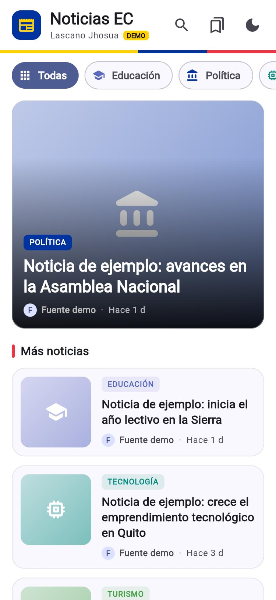
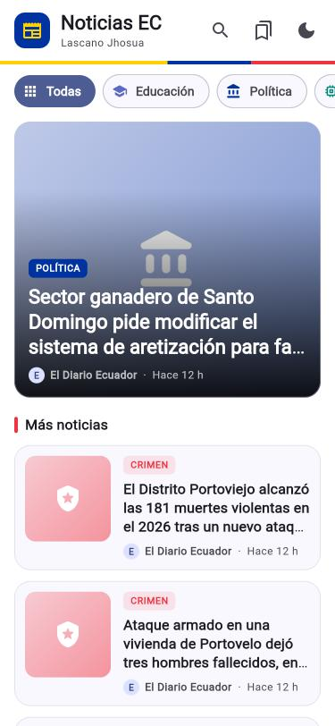
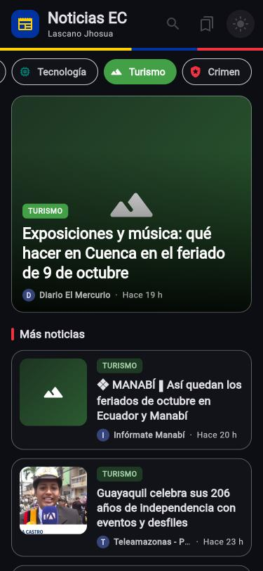

# Noticias EC Lascano Jhosua

App Flutter que consume la API REST de [NewsData.io](https://newsdata.io) y muestra
las noticias más recientes de Ecuador (`country=ec`, `language=es`), filtradas por
categoría.

| | |
|---|---|
| **Universidad** | Universidad Politécnica Estatal del Carchi — Carrera de Computación |
| **Asignatura** | Desarrollo de Aplicaciones Móviles |
| **Docente** | PhD. Samuel Lascano Rivera |
| **Período académico** | 2026B |
| **Nivel** | 7mo semestre |
| **Fecha** | 6 de octubre de 2026 |
| **Práctica N°** | 5 |
| **Integrante** | Lascano Jhosua |
| **Tema** | App Flutter de Noticias de Ecuador: consumo de una API REST |

## Capturas de pantalla

| Modo demo (sin API key) | Noticias reales de Ecuador | Detalle de una noticia |
|:---:|:---:|:---:|
|  |  |  |

| Filtro por categoría | Modo oscuro | Favoritos |
|:---:|:---:|:---:|
|  |  |  |

## Arquitectura

```
lib/
├── main.dart                       punto de entrada, tema claro/oscuro
├── models/noticia.dart             modelo + fromJson / toJson
├── services/
│   ├── news_service.dart           única capa que habla con la API REST
│   └── favoritos_service.dart      persistencia local (shared_preferences)
├── screens/
│   ├── home_screen.dart            lista, categorías, búsqueda, refresh
│   ├── detalle_screen.dart         detalle, abrir enlace, guardar favorito
│   └── favoritos_screen.dart       noticias guardadas
├── widgets/
│   ├── tarjeta_noticia.dart        tarjeta destacada y tarjeta compacta
│   ├── imagen_noticia.dart         imagen con respaldo por categoría
│   ├── categorias.dart             nombre, ícono y color de cada categoría
│   └── estados.dart                carga (esqueleto), error, vacío, franja tricolor
├── theme/app_theme.dart            colores de la bandera, tema claro y oscuro
└── utils/fechas.dart               "Hace 3 h", formato de fechas
assets/demo_noticias.json           datos de prueba (modo demo)
```

La interfaz nunca usa `http` directamente: el flujo es
`HomeScreen → NewsService → API REST → List<Noticia> → FutureBuilder → tarjetas`.

## Requisitos

- Flutter 3.38+ / Dart 3.8+ (probado con Flutter 3.47.6 / Dart 3.13.5)
- Navegador Chrome o Edge para la versión web
- Una API key gratuita de NewsData.io (opcional: sin ella se usa el modo demo)

## Ejecutar

```bash
flutter pub get
```

Modo demo (sin API key, lee `assets/demo_noticias.json`; aparece la etiqueta **DEMO**):

```bash
flutter run -d web-server --web-port 8080 --web-hostname 0.0.0.0
```

Abrir http://localhost:8080. También se puede usar `flutter run -d edge` o `-d chrome`.

Con noticias reales de Ecuador:

```bash
flutter run -d web-server --web-port 8080 --web-hostname 0.0.0.0 --dart-define=NEWS_API_KEY=TU_CLAVE
```

O bien, guardando la clave en un archivo `.env` (ignorado por Git) con la línea `NEWS_API_KEY=TU_CLAVE`:

```bash
flutter run -d web-server --web-port 8080 --web-hostname 0.0.0.0 --dart-define-from-file=.env
```

Categorías: Educación, Política, Tecnología, Turismo y Crimen. «Todas» envía
`category=education,politics,technology,tourism,crime`.

> La clave **no** se escribe en el código: se pasa al compilar con `--dart-define`.
> El hot reload no relee `--dart-define`; para cambiarla hay que detener (`q`) y volver a ejecutar.

## Compilar

```bash
flutter build web --dart-define=NEWS_API_KEY=TU_CLAVE
flutter build apk --dart-define=NEWS_API_KEY=TU_CLAVE
```

- Web: `build/web/`
- APK: `build/app/outputs/flutter-apk/app-release.apk` (el permiso `INTERNET` ya está en el `AndroidManifest.xml`)

## Pruebas y análisis

```bash
flutter analyze
flutter test
```

- `test/widget_test.dart`: `Noticia.fromJson` y el viaje de ida y vuelta `toJson`/`fromJson`.
- `test/news_service_test.dart`: `NewsService` con `MockClient` (URL y parámetros, UTF‑8, error 401, modo demo).
- `test/fechas_test.dart`: conversión de `pubDate` (UTC) a hora local y textos "Hace X h".

## Ejercicios propuestos implementados

| Ejercicio | Dónde |
|-----------|-------|
| **Buscador** — `TextField` en el AppBar que envía el parámetro `q` | `home_screen.dart`, `news_service.dart` |
| **Favoritos** — guardados con `shared_preferences` en una tercera pantalla | `favoritos_service.dart`, `favoritos_screen.dart`, `detalle_screen.dart` |
| **Modo oscuro** — `darkTheme` + interruptor en el AppBar | `main.dart`, `theme/app_theme.dart`, `home_screen.dart` |
| **Pruebas** — `NewsService` probado con `MockClient` de `http/testing.dart` | `test/news_service_test.dart` |

## Problemas frecuentes

| Síntoma | Solución |
|---------|----------|
| Error 401 | API key inválida; cópiala de nuevo del panel de NewsData.io |
| Error 429 | Se agotaron los créditos diarios del plan gratuito; usa el modo demo |
| Sale DEMO aunque pasaste la clave | Revisa `--dart-define=NEWS_API_KEY=...` y reinicia (no basta con hot reload) |
| Algunas imágenes no aparecen en web | El medio bloquea el acceso desde otro sitio; se muestra el ícono de la categoría. En el APK sí se ven |

## Conclusiones

1. **Consumo de la API REST.** Leer la documentación de NewsData.io y probar el
   endpoint antes de programar permitió conocer el formato exacto de la respuesta
   y sus parámetros (`country`, `language`, `category`, `q`). Con eso la app arma
   la URL, revisa el código HTTP, decodifica en UTF‑8 para que las tildes y la ñ
   se vean bien, y corta la espera a los 15 segundos. También aprendí que no hay
   que suponer nada de los datos: la API envía la fecha en UTC sin indicarlo en el
   texto, y hubo que convertirla a la hora de Ecuador para que no saliera 5 horas
   adelantada.

2. **Arquitectura por capas.** Separar la app en modelo, servicio y pantallas hizo
   que cada parte tenga una sola responsabilidad. `NewsService` es lo único que
   habla con internet, así que se pudo probar con `MockClient` sin gastar créditos
   de la API, y cambiar de proveedor de noticias solo requeriría tocar el servicio
   y el modelo. Gracias a esa separación, agregar búsqueda, favoritos, modo oscuro
   y el rediseño visual no obligó a reescribir la lógica de datos.

3. **Datos asíncronos y manejo de errores.** `FutureBuilder` permitió mostrar
   claramente los tres estados de una petición (cargando, error y datos), y los
   valores por defecto en `fromJson` evitaron que la app se cayera cuando la API
   envía campos nulos. El modo demo con un JSON local fue muy útil para
   desarrollar y probar la interfaz sin depender de internet ni de los créditos
   diarios.

4. **Entorno de desarrollo y buenas prácticas.** La guía plantea usar Docker para
   no instalar Flutter en el equipo y que todos trabajen con la misma versión. En
   esta práctica se usó Flutter 3.47.6 instalado localmente; las versiones quedan
   fijadas en `pubspec.lock` y documentadas en este README, lo que permite
   reproducir el proyecto, aunque un contenedor daría además un entorno aislado e
   idéntico para todos. La API key se pasa con `--dart-define` y nunca se sube al
   repositorio, y el proyecto queda con `flutter analyze` sin avisos y todas las
   pruebas pasando.

## Bibliografía

- Cirrus Labs. (s. f.). *docker-images-flutter* [Repositorio]. GitHub. https://github.com/cirruslabs/docker-images-flutter
- Dart Team. (s. f.). *http* [Paquete de Dart]. pub.dev. https://pub.dev/packages/http
- Flutter. (s. f.). *Fetch data from the internet*. Google. https://docs.flutter.dev/cookbook/networking/fetch-data
- NewsData.io. (s. f.). *NewsData.io API documentation*. https://newsdata.io/documentation
